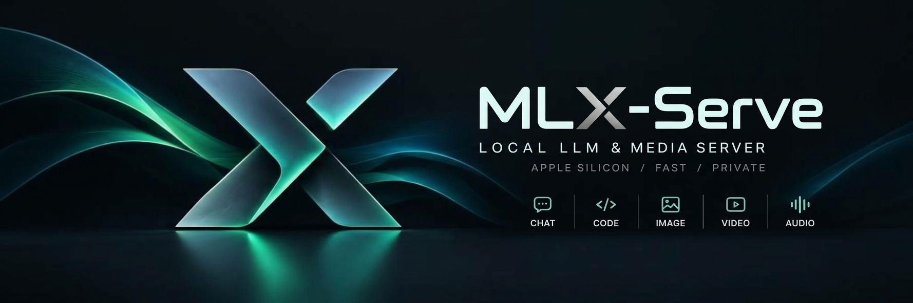
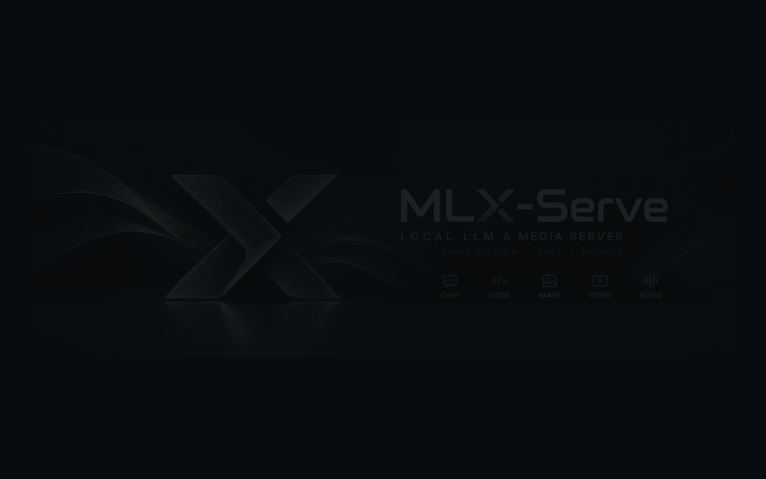
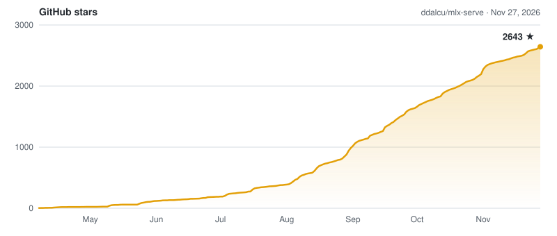

# MLX-Serve

Mac'inizde açık modelleri çalıştırın: sohbet, kodlama ajanları, görsel, video, müzik, konuşma ve 3B. OpenAI, Anthropic ve Ollama API'lerini konuşan tek bir yerel uygulama ve tek bir yerel sunucu. Çevrimdışı çalışır, Python ve hesap gerektirmez ve MIT lisanslıdır.

[](https://github.com/ddalcu/mlx-serve/releases/latest)
[](https://github.com/ddalcu/mlx-serve/releases)
[](https://github.com/ddalcu/mlx-serve/stargazers)
[](LICENSE)

**[Mac için İndir](https://github.com/ddalcu/mlx-serve/releases/latest/download/MLX-Serve.dmg)** · [Homebrew](#kurulum) · [iPhone](https://apps.apple.com/us/app/mlx-chat-local-ai/id6787603518) · [Linux](#linux-ve-windows) · [mlxserve.com](https://mlxserve.com/) · [English](README.md) · [简体中文](README.zh-CN.md)

*Bu dosya [README.md](README.md) dosyasından çevrilmiştir; İngilizce aslıyla çelişmesi durumunda İngilizce aslı geçerlidir.*



## Kurulum

**Uygulama.** [MLX-Serve'ü indirin](https://github.com/ddalcu/mlx-serve/releases/latest/download/MLX-Serve.dmg), Uygulamalar klasörüne sürükleyip açın. Apple Silicon üzerinde macOS 26.2 veya üzerini gerektirir, Mac'inize uygun bir model önerir ve kendini otomatik günceller.

**Homebrew.**

```bash
brew tap ddalcu/mlx-serve https://github.com/ddalcu/mlx-serve
brew trust ddalcu/mlx-serve
brew install --cask mlx-serve   # uygulama
brew install mlx-serve          # veya yalnızca komut satırı sunucusu
```

**Terminal**, Ollama'yı biliyorsanız:

```bash
mlx-serve run gemma4          # Gemma 4 E4B'yi indirir, sunar ve doğrudan burada sohbet eder
mlx-serve pull gemma4:26b     # yalnızca indirir, kaldığı yerden devam edebilir
mlx-serve serve               # indirdiğiniz her şeyi sunar; modeller istendiğinde yüklenir
```

Sunucu `http://localhost:11234` adresini dinler. Herhangi bir OpenAI, Anthropic veya Ollama istemcisini bu adrese yönlendirin ya da yerleşik web konsolu için bu adresi tarayıcıda açın.

### iPhone

[MLX-Serve](https://apps.apple.com/us/app/mlx-chat-local-ai/id6787603518) aynı motoru iPhone'unuza taşır: Gemma 4 ile sohbet edin, sesinizi klonlayın, görsel ve müzik üretin — hepsi telefonun üzerinde ve çevrimdışı. iOS 26 çalıştıran A17 Pro sınıfı veya daha yeni bir iPhone gerektirir.

### Linux ve Windows

Her sürümde NVIDIA GPU'lar için Linux indirmeleri bulunur: RTX 20 ile 50 serisi kartlar için x64; DGX Spark, GH200 ve Jetson Thor için arm64. NVIDIA kartlı Windows'ta tek bir betik uygulamayı derler. Ayrıntılar [docs/building.md](docs/building.md#linux-and-windows-nvidia) dosyasında yer alır.

## Neler yapar

- **Yerel model üzerinde kodlama ajanları.** `mlx-serve launch claude`, Claude Code'u modelin gerçek bağlam penceresiyle yapılandırılmış şekilde Mac'inize karşı başlatır. Codex, OpenCode, pi, Grok ve diğerleri aynı şekilde çalışır. [Entegrasyonlar](docs/integrations.md)
- **Görsel, video, müzik, konuşma ve 3B.** FLUX.2, Qwen-Image, MiniMax-H3-Image, Krea, MOSS-Image, LTX-Video, MiniMax-H3, ACE-Step, YuE2, ses klonlamalı Qwen3-TTS ve Hunyuan3D — uygulamada veya HTTP üzerinden. [Uygulama](docs/app.md)
- **Dökümler ve toplantı notları.** Sözcük zamanlamaları ve kimin ne söylediği bilgisiyle 30 dilde konuşmadan metne dönüştürme. Menü çubuğu bir görüşmeyi kaydedip notlarını çıkarır. [API](docs/api.md#other-endpoints)
- **Mac'inizden büyük modeller.** GLM-5.3-Flash ve DeepSeek-V4.1-Flash, uzman (expert) katmanlarını SSD'den okuyarak 128 GB'lık bir Mac'te çalışır. Thunderbolt 5 kablosuyla bağlı iki Mac tek bir modeli birlikte çalıştırabilir ve ağınızdaki Mac'ler birbirinin modellerini kullanabilir. [CLI](docs/cli.md) · [SSS](docs/faq.md#can-my-macs-share-models-over-the-network)
- **Mac'inizde yaşayan bir asistan.** Belgelerinizle sohbet edin, eller serbest konuşun, ajanlara yalıtılmış kabuk ve MCP araçları verin veya düz metinle görevler zamanlayın. [Uygulama](docs/app.md)
- **Araçlarınızın halihazırda kullandığı API'ler.** OpenAI chat, completions ve Responses, Anthropic Messages ve Ollama — hepsi tek bir portta; akış (streaming), araç çağrıları, JSON şemaları, görsel anlama ve akıl yürütme desteğiyle. [API](docs/api.md)

## Mac'im neleri çalıştırabilir?

Uygulama, Mac'inizin belleğine göre bir ilk model önerir:

| Bellek | Önerilen model |
|---|---|
| 16 GB | Gemma 4 E4B |
| 18–24 GB | Gemma 4 12B |
| 32 GB | Qwen 3.8 27B |
| 36 GB | Qwen 3.8 27B 6-bit |
| 48–64 GB | Qwen 3.8 27B 8-bit |
| 96 GB ve üzeri | Qwen3.8-Flash-Next (125B, token başına yaklaşık 6B etkin) |
| 128 GB | Ayrıca uzman katmanları SSD'den aktarılan GLM-5.3-Flash ve DeepSeek-V4.1-Flash |
| 256 GB | Ayrıca bellekte GLM-5.3-Flash (NVIDIA'nın FP4 paketi) |

Binlercesi daha çalışır: desteklenen bir mimariye sahip herhangi bir MLX modeli ve herhangi bir GGUF. [Katman listesi](https://mlxserve.com/llm-tier-list/) popüler modelleri sıralar ve [docs/models.md](docs/models.md) her mimariyi listeler.

## Hız

256 GB'lık M5 Ultra üzerinde, kod isteminde, spekülatif çözümleme (speculative decoding) açıkken v26.11.4 çözümleme hızı:

| Model | Saniyede token |
|---|---:|
| Qwen3.6 35B-A3B, 4-bit | 436 |
| Qwen3.8 27B, 4-bit | 250 |
| Gemma 4 E4B, 4-bit | 197 |
| Gemma 4 26B-A4B, 4-bit | 186 |
| Qwen3.8-Flash-Next, 4.7 bit | 164 |

M4 Max üzerinde aynı modeller v26.8'e kıyasla %10 ile %47 arasında daha hızlı çözümlenir. Her sürüm [benchmarks.md](benchmarks.md) içinde aynı yöntemle ölçülür; spekülatif çözümleme ve ince ayar [docs/performance.md](docs/performance.md) belgesindedir.

## Belgeler

- [Entegrasyonlar](docs/integrations.md): Claude Code, Codex, OpenCode, pi, Zed ve daha fazlası
- [HTTP API](docs/api.md): OpenAI, Anthropic, Ollama ve medya uç noktaları
- [CLI ve sunucu bayrakları](docs/cli.md)
- [Mac uygulaması](docs/app.md), medya turuyla birlikte
- [Desteklenen modeller](docs/models.md)
- Sunucuyu yeniden derlemeden eklenti yazın: [model](docs/plugin-model.md), [medya](docs/plugin-media.md), [kuantizasyon](docs/plugin-quant.md)
- [Performans ve ince ayar](docs/performance.md)
- [Kaynak koddan derleme](docs/building.md) ve [NVIDIA GPU'lar](docs/CUDA.md)
- [SSS](docs/faq.md) ve [değişiklik günlüğü](CHANGELOG.md)

## Kaynak koddan derleme

Xcode 26.2 veya üzeri ve [Homebrew](https://brew.sh) gerekir:

```bash
git clone --recurse-submodules https://github.com/ddalcu/mlx-serve && cd mlx-serve
./app/build.sh
```

Betik sabitlenen Zig sürümünü indirir, MLX ve llama.cpp'yi derler ve uygulamayı geçici (ad hoc) olarak imzalar. Derleme sürecinin hiçbir yerinde Python yoktur. Yalnızca sunucu derlemeleri [docs/building.md](docs/building.md) belgesindedir.

## Topluluk

Sorular, fikirler ve ürettikleriniz için: [X topluluk sohbeti](https://x.com/i/chat/group_join/g2108335256541741397/K38XS6aGRh) ve [GitHub issues](https://github.com/ddalcu/mlx-serve/issues). Derlemeler ve teknik incelemeler [YouTube](https://www.youtube.com/@DavidDalcu) ve [X](https://x.com/ddalcu) üzerinde yayınlanır.

## Teşekkürler

mlx-serve'ü destekleyen sponsorlara teşekkürler: @jcprichard, @skudinov, @davidfekke, @lojza3d, @cpko, @d-b, @alinselea, @sbusso, @Yue-Hao, @HLGRL, @iTAGXX, @abeansits, @VincentRK, @davecrist, @djnmrjnvc, @travishaby, Ivan Fioravanti, Patrik Svancara, Jaroslav, Marius, Johnny Dang, @R0xr1te ve anonim olarak destek veren iki bağışçı. İşinize yarıyorsa [GitHub Sponsors](https://github.com/sponsors/ddalcu) veya [Buy Me a Coffee](https://buymeacoffee.com/ddalcu) üzerinden destek olabilirsiniz. Hiçbir özellik ödeme duvarı arkasında değildir: şimdi MIT lisanslıdır ve MIT kalacaktır.

Kod, hata bildirimi ve fikir gönderen herkese de teşekkürler. [Katkıda bulunanlar sayfası](https://github.com/ddalcu/mlx-serve/graphs/contributors) kod tarafını gösterir; [değişiklik günlüğü](CHANGELOG.md) ise sürüm sürüm teşekkür eder.

## Kaynaklar ve atıflar

mlx-serve şu projeler üzerine kuruludur: [MLX](https://github.com/ml-explore/mlx), [mlx-c](https://github.com/ml-explore/mlx-c), [mlx-lm](https://github.com/ml-explore/mlx-lm), [llama.cpp](https://github.com/ggerganov/llama.cpp), [antirez/ds4](https://github.com/antirez/ds4), [mlx-stream](https://github.com/davidtai/mlx-stream), [Sushi](https://github.com/beamivalice/sushi), [jinja.cpp](https://github.com/wangzhaode/jinja.cpp), [nlohmann/json](https://github.com/nlohmann/json), [stb_image](https://github.com/nothings/stb), [libwebp](https://chromium.googlesource.com/webm/libwebp), [Hugging Face tokenizers](https://github.com/huggingface/tokenizers) ve [Zig](https://ziglang.org). Yazarlarının yayınladığı açık modelleri çalıştırır ve uygulama [Anthropic](https://github.com/anthropics/swift-sdk) ile [MCP](https://github.com/modelcontextprotocol/swift-sdk) Swift SDK'larını kullanır.

Lisanslar ve zorunlu bildirimler [NOTICE](NOTICE) dosyasında yer alır. Birini unuttuysak lütfen bir PR açın.

## Yıldız geçmişi

<picture>
  <source media="(prefers-color-scheme: dark)" srcset="docs/star-history-dark.svg">
  
</picture>

<!-- regenerate with: python3 scripts/star-chart.py -->

[](https://trendshift.io/repositories/43025)

mlx-serve işinize yarıyorsa bir yıldız bırakmak başkalarının da onu bulmasına yardımcı olur.

## Lisans

MIT, bkz. [LICENSE](LICENSE). Dahil edilen üçüncü taraf kodlar kendi lisanslarını korur: [NOTICE](NOTICE) gerekli atıflarla birlikte bunları listeler ve [LICENSE-APACHE-2.0](LICENSE-APACHE-2.0) Apache lisans metnini içerir.
