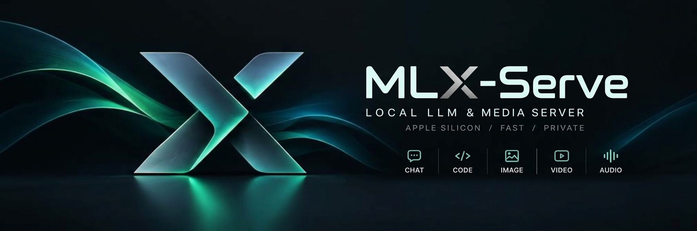
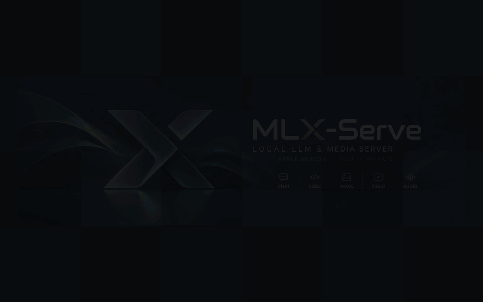
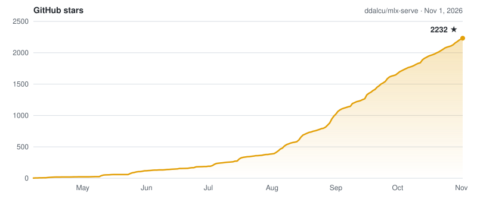

# mlx-serve

在你的 Mac 上运行开源模型：聊天、编码 Agent、图像、视频、音乐、语音与 3D。一个原生应用加一个本地服务器，兼容 OpenAI、Anthropic 与 Ollama API。可离线运行，无需 Python，无需账号，采用 MIT 许可。

[](https://github.com/ddalcu/mlx-serve/releases/latest)
[](https://github.com/ddalcu/mlx-serve/releases)
[](https://github.com/ddalcu/mlx-serve/stargazers)
[](LICENSE)

**[下载 Mac 版](https://github.com/ddalcu/mlx-serve/releases/latest/download/MLX-Serve.dmg)** · [Homebrew](#安装) · [iPhone](https://apps.apple.com/us/app/mlx-chat-local-ai/id6787603518) · [Linux](#linux-与-windows) · [mlxserve.com](https://mlxserve.com/) · [English](README.md)

*本文件译自 [README.md](README.md)，如与英文原文有出入，以英文原文为准。*



## 安装

**应用。** [下载 MLX-Serve](https://github.com/ddalcu/mlx-serve/releases/latest/download/MLX-Serve.dmg)，拖进“应用程序”文件夹后打开。需要 Apple Silicon 上的 macOS 26.2 或更高版本；它会推荐适合你这台 Mac 的模型，并自动更新。

**Homebrew。**

```bash
brew tap ddalcu/mlx-serve https://github.com/ddalcu/mlx-serve
brew trust ddalcu/mlx-serve
brew install --cask mlx-serve   # 应用
brew install mlx-serve          # 或者只装命令行服务器
```

**终端**，如果你用过 Ollama：

```bash
mlx-serve run gemma4          # 下载 Gemma 4 E4B，启动服务并直接在终端里聊天
mlx-serve pull gemma4:26b     # 只下载，支持断点续传
mlx-serve serve               # 对外提供你下载过的全部模型，按需加载
```

服务器监听 `http://localhost:11234`。任何 OpenAI、Anthropic 或 Ollama 客户端都能直接连上；在浏览器里打开这个地址，就是内置的网页控制台。

### iPhone

[MLX-Serve](https://apps.apple.com/us/app/mlx-chat-local-ai/id6787603518) 把同一个引擎带到你的 iPhone 上：和 Gemma 4 聊天、克隆你的声音、生成图片和音乐，全部在手机上离线完成。需要 A17 Pro 级别或更新的 iPhone，以及 iOS 26。

### Linux 与 Windows

每个版本都提供面向 NVIDIA GPU 的 Linux 下载包：x64 版适用于 RTX 20 到 50 系列显卡，arm64 版适用于 DGX Spark、GH200 与 Jetson Thor。在装有 NVIDIA 显卡的 Windows 上，一个脚本就能完成构建。详见 [docs/building.md](docs/zh-CN/building.md#linux-与-windowsnvidia)。

## 它能做什么

- **在本地模型上跑编码 Agent。** `mlx-serve launch claude` 会启动连接到你这台 Mac 的 Claude Code，并按模型真实的上下文窗口配置好。Codex、OpenCode、pi、Grok 等也一样。[集成](docs/zh-CN/integrations.md)
- **图像、视频、音乐、语音与 3D。** FLUX.2、Qwen-Image、Krea、MOSS-Image、LTX-Video、MiniMax-H3、ACE-Step、YuE2、支持语音克隆的 Qwen3-TTS，以及 Hunyuan3D，在应用里或通过 HTTP 都能用。[应用](docs/zh-CN/app.md)
- **转写与会议纪要。** 30 种语言的语音转文字，带逐词时间戳和说话人区分。菜单栏能录下一通会议并写好纪要。[API](docs/zh-CN/api.md#其它端点)
- **比你的 Mac 更大的模型。** GLM-5.3-Flash、MiMo-V2.6-Flash 与 DeepSeek-V4.1-Flash 从 SSD 读取专家权重，在 128 GB 的 Mac 上就能运行。两台 Mac 用一根 Thunderbolt 5 线连起来，可以一起跑一个模型；局域网里的 Mac 也能互相使用对方的模型。[CLI](docs/zh-CN/cli.md) · [常见问题](docs/zh-CN/faq.md#我的多台-mac-能通过网络共享模型吗)
- **住在你 Mac 上的助手。** 和你的文档对话，免提语音交流，给 Agent 一个沙盒 shell 和 MCP 工具，或者用自然语言安排定时任务。[应用](docs/zh-CN/app.md)
- **你的工具已经在用的 API。** OpenAI 的 chat、completions 与 Responses，Anthropic Messages，以及 Ollama，全在同一个端口上，支持流式输出、工具调用、JSON Schema、视觉与推理。[API](docs/zh-CN/api.md)

## 我的 Mac 能跑什么？

应用会按你的 Mac 内存推荐第一个模型：

| 内存 | 推荐模型 |
|---|---|
| 16 GB | Gemma 4 E4B |
| 18–24 GB | Gemma 4 12B |
| 32 GB | Qwen 3.8 27B |
| 36 GB | Qwen 3.8 27B 6-bit |
| 48–64 GB | Qwen 3.8 27B 8-bit |
| 96 GB 及以上 | Qwen3.8-Flash-Next（125B，每个 token 约激活 6B） |
| 128 GB | 另加 GLM-5.3-Flash、MiMo-V2.6-Flash 与 DeepSeek-V4.1-Flash，从 SSD 流式读取 |
| 256 GB | 另加 GLM-5.3（744B），从 SSD 流式读取 |

还有成千上万个模型也能跑：任何受支持架构的 MLX 模型，以及任何 GGUF。[天梯榜](https://mlxserve.com/llm-tier-list/)给热门模型排了名，[docs/models.md](docs/zh-CN/models.md) 列出了每一种架构。

## 速度

v26.10.2 在 256 GB 的 M5 Ultra 上的解码速度（代码提示词，开启投机解码）：

| 模型 | 每秒 token 数 |
|---|---:|
| Qwen3.6 35B-A3B，4-bit | 416 |
| Qwen3.8 27B，4-bit | 242 |
| Gemma 4 E4B，4-bit | 196 |
| Gemma 4 26B-A4B，4-bit | 187 |
| Qwen3.8-Flash-Next，4.7 bit | 169 |

在 M4 Max 上，同样这些模型的解码速度比 v26.8 时快了 9% 到 56%。每个版本都用同一种方法测量，记录在 [benchmarks.md](benchmarks.md)；投机解码与调优见 [docs/performance.md](docs/zh-CN/performance.md)。

## 文档

- [集成](docs/zh-CN/integrations.md)：Claude Code、Codex、OpenCode、pi、Zed 等
- [HTTP API](docs/zh-CN/api.md)：OpenAI、Anthropic、Ollama 与媒体端点
- [CLI 与服务器参数](docs/zh-CN/cli.md)
- [Mac 应用](docs/zh-CN/app.md)，含媒体生成导览
- [支持的模型](docs/zh-CN/models.md)
- [性能与调优](docs/zh-CN/performance.md)
- [从源码构建](docs/zh-CN/building.md)与 [NVIDIA GPU](docs/CUDA.md)（英文）
- [常见问题](docs/zh-CN/faq.md)与[更新日志](CHANGELOG.md)

## 从源码构建

需要 Xcode 26.2 或更高版本，以及 [Homebrew](https://brew.sh)：

```bash
git clone --recurse-submodules https://github.com/ddalcu/mlx-serve && cd mlx-serve
./app/build.sh
```

脚本会拉取固定版本的 Zig，构建 MLX 与 llama.cpp，并对应用做 ad-hoc 签名。整个构建过程不需要 Python。仅构建服务器的方法见 [docs/building.md](docs/zh-CN/building.md)。

## 社区

提问、想法和你做出来的东西：[X 上的社区群聊](https://x.com/i/chat/group_join/g2108335256541741397/K38XS6aGRh)与 [GitHub issues](https://github.com/ddalcu/mlx-serve/issues)。构建过程与深度拆解会发在 [YouTube](https://www.youtube.com/@DavidDalcu) 和 [X](https://x.com/ddalcu) 上。

## 感谢

感谢支持 mlx-serve 的赞助者：@jcprichard、@skudinov、@davidfekke、@lojza3d、@cpko、@d-b、@alinselea、Johnny Dang 与 @R0xr1te。如果它对你有用，可以通过 [GitHub Sponsors](https://github.com/sponsors/ddalcu) 或 [Buy Me a Coffee](https://buymeacoffee.com/ddalcu) 支持它。没有任何功能收费：现在是 MIT，以后也是 MIT。

也感谢每一位贡献代码、报告问题和提出想法的人。[贡献者页面](https://github.com/ddalcu/mlx-serve/graphs/contributors)记录了代码方面的贡献，[更新日志](CHANGELOG.md)在每个版本里逐一致谢。

## 致谢

mlx-serve 构建于 [MLX](https://github.com/ml-explore/mlx)、[mlx-c](https://github.com/ml-explore/mlx-c)、[mlx-lm](https://github.com/ml-explore/mlx-lm)、[llama.cpp](https://github.com/ggerganov/llama.cpp)、[antirez/ds4](https://github.com/antirez/ds4)、[mlx-stream](https://github.com/davidtai/mlx-stream)、[Sushi](https://github.com/beamivalice/sushi)、[jinja.cpp](https://github.com/wangzhaode/jinja.cpp)、[nlohmann/json](https://github.com/nlohmann/json)、[stb_image](https://github.com/nothings/stb)、[libwebp](https://chromium.googlesource.com/webm/libwebp)、[Hugging Face tokenizers](https://github.com/huggingface/tokenizers) 与 [Zig](https://ziglang.org) 之上。它运行的是各位作者公开发布的开源模型，应用里还用到了 [Anthropic](https://github.com/anthropics/swift-sdk) 与 [MCP](https://github.com/modelcontextprotocol/swift-sdk) 的 Swift SDK。

引擎里一些最快的 Metal 路径最初出自别人之手，源码在每一处都注明了出处：

- [MTPLX](https://github.com/youssofal/mtplx)，作者 Youssof Altoukhi（Apache-2.0）：verify-width split-K 量化矩阵乘法与 M5 NAX tile。*Powered by MTPLX by Youssof Altoukhi.*
- [dflash-mlx](https://github.com/bstnxbt/dflash-mlx)（Apache-2.0）：NAX tile 所基于的 matmul2d 约定。
- oMLX，作者 jundot（Apache-2.0）：GatedDeltaNet 分块预填充 kernel，以及长提示词的分块调度预算。
- [mlxfast-challenge](https://github.com/Layr-Labs/mlxfast-challenge)，作者 Layr Labs（MIT）：解码注意力重量化、融合 QK-norm + RoPE kernel，以及融合 MoE down-reduce。

许可证与必需的声明见 [NOTICE](NOTICE)。如果我们漏掉了你，请开一个 PR。

## Star 历史

<picture>
  <source media="(prefers-color-scheme: dark)" srcset="docs/star-history-dark.svg">
  
</picture>

<!-- regenerate with: python3 scripts/star-chart.py -->

[](https://trendshift.io/repositories/43025)

如果 mlx-serve 对你有用，点一个 star 能帮更多人找到它。

## 许可

MIT，见 [LICENSE](LICENSE)。随包分发的第三方代码保留各自的许可证：[NOTICE](NOTICE) 列出了它们及必需的署名，[LICENSE-APACHE-2.0](LICENSE-APACHE-2.0) 是 Apache 许可证文本。
