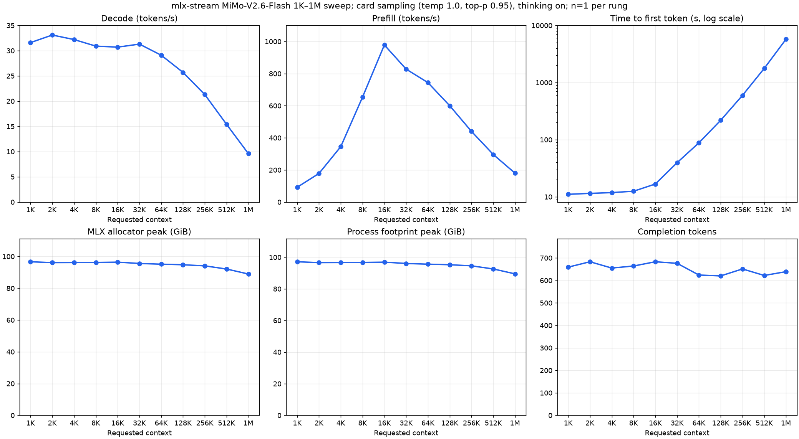
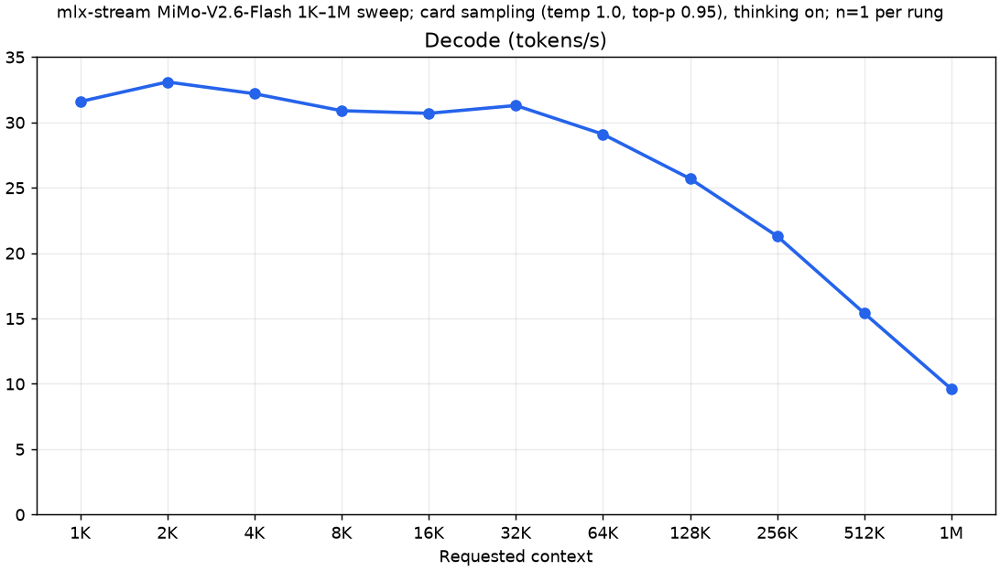
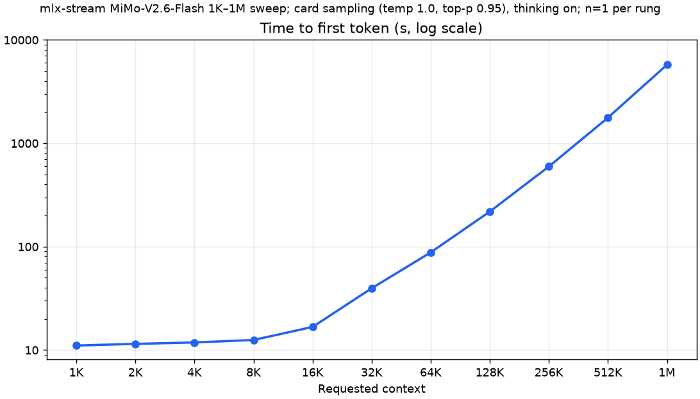
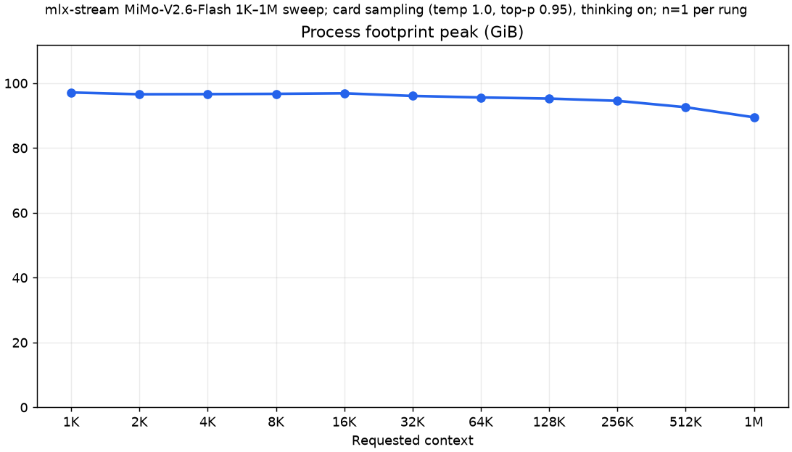
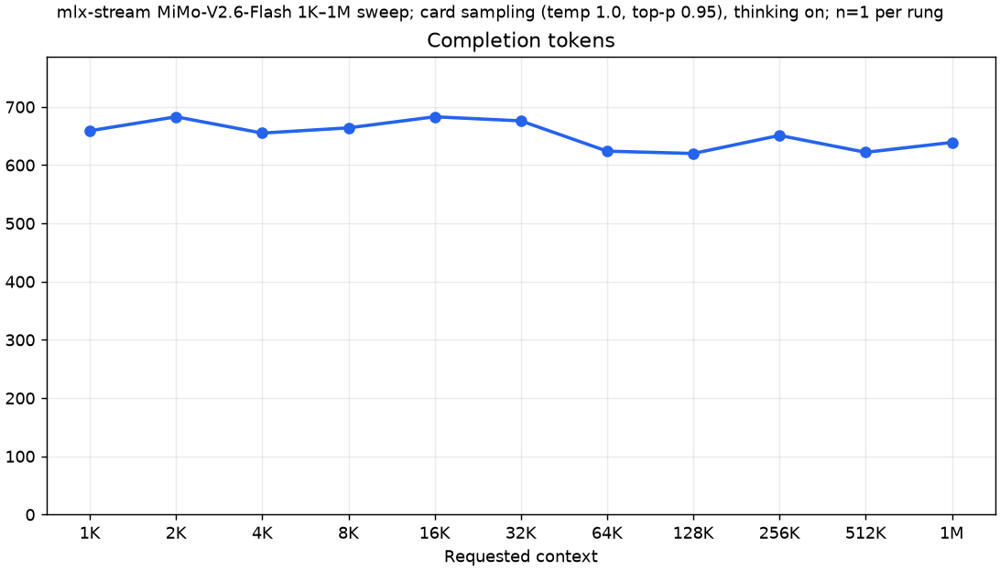

# MiMo-V2.6-Flash 1K–1M sweep: benchmark record

This directory records mlx-serve serving MiMo-V2.6-Flash's streaming pack
through the mlx-stream plugin (`lib/mlx-stream`, [plugins.md](../../plugins.md))
across context: one request per context rung, from 1K to 1M prompt tokens, on
server `746e7da9` (this host, `pr/mimo-host` at `2c041af6`, with mlx-stream
at `8e7d186`, from the plugin's MiMo PR, since merged into its `main`), with the plugin's
attention kernels at every served context. The plugin's `docs/mimo.md` describes
the arch, and its `scripts/mimo_sweep_charts.py` rebuilds `results.json` from
the cell receipts and draws the charts here. The 32K route-gate fix is
documented in the plugin's `docs/mimo.md` and the PR.



## Matched serving configuration

Every rung used the same pack, server flags and request shape:

- Apple M5 Max with 128 GB of unified memory, fans at maximum, no other model
  server loaded, each server run serialized by the machine's exclusive GPU
  guard;
- pack `OpensourceWTF/MiMo-V2.6-Flash-MOPD-fp8res-mlx-stream`: the release's
  MXFP4 experts streamed from the internal SSD, FP8 residents;
- GPU memory ceiling 112 GiB (`MLX_SERVE_GPU_CEILING_MB=114688`, the wired limit
  raised to match) with `--wired-margin-gib 2`;
- 16-bit KV cache (BF16, `--kv-quant off`), prefix cache off;
- the MTP draft lane at its defaults (typical acceptance 0.5, three heads;
  `"enable_mtp": true`);
- card sampling: temperature 1.0, top-p 0.95, seed 1, no top-k; thinking on;
  `max_tokens` 16,384;
- a fresh server per rung, serving one request: `POST /v1/completions` with the
  prompt rendered by the pack's chat template.

```sh
MLX_SERVE_GPU_CEILING_MB=114688 nice -n 19 mlx-serve serve --model <pack> \
  --host 127.0.0.1 --port 8081 --ctx-size <served context> --timeout 0 \
  --no-vision --no-warmup-eager --prefix-cache-entries 0 --metrics \
  --log-file off --kv-quant off --wired-margin-gib 2
```

Every server logs `decode_attention=kernels` and `prefill_attention=nax`: the
split-K decode attention and the NAX prompt attention at every rung, up to the
1M rung's 1,048,576 keys.

Requested context is the prompt fixture's nominal length; the served context
(`--ctx-size`) adds the 16,384-token cap. The 1M fixture is 1,032,192 tokens, so
that its served context is the checkpoint's 1,048,576-token limit. Actual input
is the server's prompt count: with thinking on the request drops the fixture's
trailing `<think></think>`, two tokens.

Expert rows (slot rows per routed layer, prompt phase / decode phase) were
pinned per rung in the pack's `config.json` at the memory bill's fill for a 12.6
GB box baseline, with one prompt row less from 64K up for the bill's NAX
prompt-attention term. The rows fall with context as the bill gives memory to
the KV.

| Requested context | Served context | Rows P/D |
| ---: | ---: | ---: |
| 1K | 17,407 | 130/147 |
| 2K | 18,432 | 129/146 |
| 4K | 20,480 | 129/146 |
| 8K | 24,576 | 129/146 |
| 16K | 32,768 | 129/146 |
| 32K | 49,152 | 128/144 |
| 64K | 81,920 | 125/142 |
| 128K | 147,456 | 121/139 |
| 256K | 278,528 | 114/133 |
| 512K | 540,671 | 98/120 |
| 1M | 1,048,576 | 67/96 |

Every point is one request (n=1), with no uncertainty interval. `results.json`
holds the 11 rows.

## Decode

| Requested context | Actual input | Rows P/D | Decode (tok/s) |
| ---: | ---: | ---: | ---: |
| 1K | 1,021 | 130/147 | 31.6 |
| 2K | 2,046 | 129/146 | 33.1 |
| 4K | 4,094 | 129/146 | 32.2 |
| 8K | 8,190 | 129/146 | 30.9 |
| 16K | 16,382 | 129/146 | 30.7 |
| 32K | 32,766 | 128/144 | 31.3 |
| 64K | 65,534 | 125/142 | 29.1 |
| 128K | 131,070 | 121/139 | 25.7 |
| 256K | 262,142 | 114/133 | 21.3 |
| 512K | 524,285 | 98/120 | 15.4 |
| 1M | 1,032,190 | 67/96 | 9.6 |



Decode holds 29.1–33.1 tok/s from 1K to 64K, then reads 25.7 at 128K, 21.3 at
256K, 15.4 at 512K and 9.6 at 1M, where the bill leaves 67/96 rows per layer
against 130/147 at 1K.

## Prefill

| Requested context | Actual input | Rows P/D | Prefill (tok/s) |
| ---: | ---: | ---: | ---: |
| 1K | 1,021 | 130/147 | 92.3 |
| 2K | 2,046 | 129/146 | 178.3 |
| 4K | 4,094 | 129/146 | 345.5 |
| 8K | 8,190 | 129/146 | 654.4 |
| 16K | 16,382 | 129/146 | 978.5 |
| 32K | 32,766 | 128/144 | 827.8 |
| 64K | 65,534 | 125/142 | 743.9 |
| 128K | 131,070 | 121/139 | 599.9 |
| 256K | 262,142 | 114/133 | 439.9 |
| 512K | 524,285 | 98/120 | 296.1 |
| 1M | 1,032,190 | 67/96 | 179.6 |


Every rung is a fresh server's first request, and a fixed cost of about 11 s
dominates its TTFT at 1K–8K, so prefill rises to its 16K peak (978.5 tok/s)
before attention's growth with the prompt brings it down: 599.9 tok/s at 128K,
296.1 at 512K, 179.6 at 1M. Prefill follows the GPU clock, which moves it by
about 6% from run to run.

## Time to first token

| Requested context | Actual input | Rows P/D | TTFT (s) |
| ---: | ---: | ---: | ---: |
| 1K | 1,021 | 130/147 | 11.06 |
| 2K | 2,046 | 129/146 | 11.48 |
| 4K | 4,094 | 129/146 | 11.85 |
| 8K | 8,190 | 129/146 | 12.52 |
| 16K | 16,382 | 129/146 | 16.74 |
| 32K | 32,766 | 128/144 | 39.58 |
| 64K | 65,534 | 125/142 | 88.10 |
| 128K | 131,070 | 121/139 | 218.49 |
| 256K | 262,142 | 114/133 | 595.91 |
| 512K | 524,285 | 98/120 | 1,770.63 |
| 1M | 1,032,190 | 67/96 | 5,747.16 |



TTFT is prompt tokens / the server's prefill rate, as the receipts derive it
from the server's per-request line: the prompt pass without the HTTP round trip,
at the prefill rate's 0.1 tok/s rounding. The 1M rung's 1,032,190-token prompt
takes 5,747 s (1.6 h).

## MLX allocator peak

| Requested context | Actual input | Rows P/D | MLX allocator peak (GiB) |
| ---: | ---: | ---: | ---: |
| 1K | 1,021 | 130/147 | 96.67 |
| 2K | 2,046 | 129/146 | 96.11 |
| 4K | 4,094 | 129/146 | 96.15 |
| 8K | 8,190 | 129/146 | 96.24 |
| 16K | 16,382 | 129/146 | 96.42 |
| 32K | 32,766 | 128/144 | 95.60 |
| 64K | 65,534 | 125/142 | 95.13 |
| 128K | 131,070 | 121/139 | 94.78 |
| 256K | 262,142 | 114/133 | 94.08 |
| 512K | 524,285 | 98/120 | 92.10 |
| 1M | 1,032,190 | 67/96 | 88.95 |


`mlx_peak` from the plugin's `MiMo decode memory` line, logged once at the end
of the request: MLX's peak since the server started, one request per server. It
falls from 96.67 GiB at 1K to 88.95 GiB at 1M as the bill gives expert rows to
the KV.

## Process footprint peak

| Requested context | Actual input | Rows P/D | Process footprint peak (GiB) |
| ---: | ---: | ---: | ---: |
| 1K | 1,021 | 130/147 | 97.15 |
| 2K | 2,046 | 129/146 | 96.59 |
| 4K | 4,094 | 129/146 | 96.63 |
| 8K | 8,190 | 129/146 | 96.72 |
| 16K | 16,382 | 129/146 | 96.89 |
| 32K | 32,766 | 128/144 | 96.07 |
| 64K | 65,534 | 125/142 | 95.61 |
| 128K | 131,070 | 121/139 | 95.26 |
| 256K | 262,142 | 114/133 | 94.57 |
| 512K | 524,285 | 98/120 | 92.60 |
| 1M | 1,032,190 | 67/96 | 89.48 |



The server process's lifetime peak physical footprint
(`darwin_peak_footprint_bytes` in the receipt, sampled every half second). It
and the MLX peak have different scopes and must not be added. Every rung stayed
under the bill's process bound (97.9–98.6 GiB): by 1.4–3.6 GiB to 256K, 5.3 GiB
at 512K and 8.7 GiB at 1M. The whole machine peaked at 103.1–108.5 GiB against
the 112 GiB ceiling. mlx-stream's README quotes the same footprints in decimal
GB (104.31 GB = 97.15 GiB at 1K).

## Completion tokens

| Requested context | Actual input | Rows P/D | Completion tokens |
| ---: | ---: | ---: | ---: |
| 1K | 1,021 | 130/147 | 659 |
| 2K | 2,046 | 129/146 | 683 |
| 4K | 4,094 | 129/146 | 655 |
| 8K | 8,190 | 129/146 | 664 |
| 16K | 16,382 | 129/146 | 683 |
| 32K | 32,766 | 128/144 | 676 |
| 64K | 65,534 | 125/142 | 624 |
| 128K | 131,070 | 121/139 | 620 |
| 256K | 262,142 | 114/133 | 651 |
| 512K | 524,285 | 98/120 | 622 |
| 1M | 1,032,190 | 67/96 | 639 |



Every request stopped on EOS (`finish_reason: stop`) after 620–683 tokens, well
short of the 16,384-token cap.

## Provenance and receipts

- Cells: the 11 cells of the lab's
  `reports/dsv41-f39-tcq3-runtime/mimo/cells/ladder3-20261011`, outside this
  repository. Each rung's `<rung>/cell/` holds `receipt.json` (the server
  command and environment, the request body, the numbers), `request.json`,
  `response.json`, `server.log` and `output.txt`. `results.json` names each
  row's cell and the SHA-256 of its receipt, prompt and output.
- Binary: server SHA-256 `746e7da9`, built from host `2c041af6` and plugin
  `8e7d186`. The binary of record, g15 `4b018c54` (host `2c041af6` and plugin
  `05fc760`: `8e7d186` plus the hot-path audit and the dead-code sweep),
  reproduces `746e7da9`'s token ids at 16K (cell stamp16k-g15-20261011).
- Runs, 2026-10-11: 1K–512K in one chain, 17:13–18:06Z; 1M alone, 18:08–19:46Z,
  after the chain's pre-launch memory gate skipped it and the box settled.
- Prefill and decode are the server's own per-request line, e.g. `<- 16382+683
  tokens (39186ms) [prefill: 978.5 tok/s, decode: 30.7 tok/s] [stop]`.
  mlx-stream's `python3 scripts/mimo_sweep_charts.py --cells-root <cells>`
  rebuilds `results.json` from the ladder's cells, checking each receipt against
  that line, the rung's `DONE` line and the chain's `LADDER_ROW` line; without
  `--cells-root` it redraws the PNGs from `results.json`, and `--tables` prints
  this README's tables.
